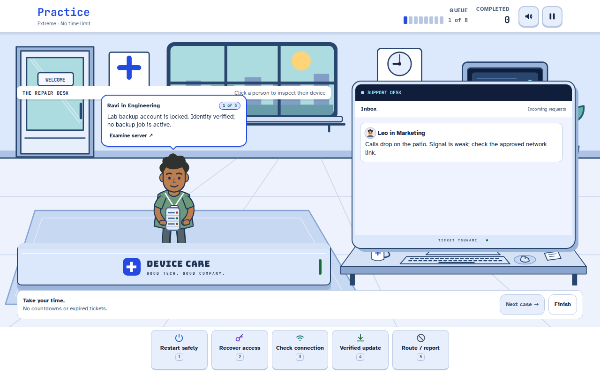
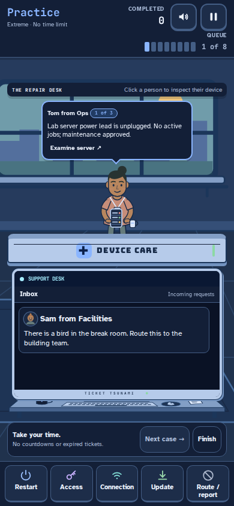
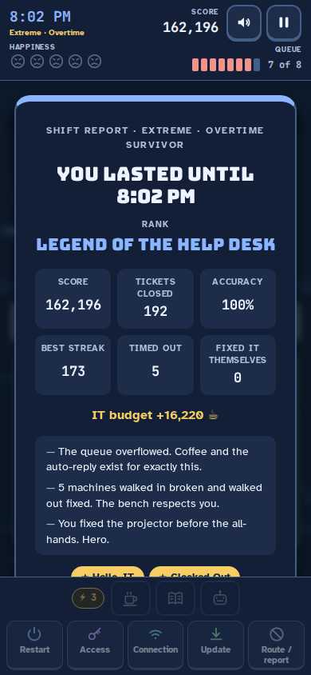

# Ticket Tsunami

[](https://github.com/WaylandP/ticket-tsunami/actions/workflows/ci.yml)

A help desk survival game for your browser. It's 9 AM, you're the only one on
the help desk, and the tickets are coming. Read each one, pick the fix that
actually solves it, and keep the queue from flooding until 5 PM — or go down
swinging in overtime.

### ▶ [Play it now](https://ticket-tsunami.vercel.app)



| Phone, dark mode | Shift report |
| --- | --- |
|  |  |

## How to play

- Pick your day before you clock in: **Casual Friday**, **Nine to Five** or
  **Monday**. Harder days pay more points, and each keeps its own best score.
- Tickets pile up in the queue. The highlighted one is the most urgent.
- Pick a fix with the buttons or keys **1–5**: Restart it, Reset password,
  Check connection, Install updates, or Not an IT problem.
- The right fix closes the ticket. Faster fixes score more, streaks multiply
  your score, and VIP tickets pay double.
- The wrong fix burns the user's patience. Let a ticket time out or the queue
  overflow and someone gets unhappy. Five unhappy users and your shift is over.
- Watch for **junk mail**: closing a scam with "Not an IT problem" pays 1.5x,
  and letting it time out costs nothing. Some closed tickets **come back**
  ("RE: …"), and when something catches fire, points double for 8 seconds.
- Every 10-ticket streak earns a **power charge**. Spend it on ☕ Coffee
  (**Q**, slows everything for 5s), 📖 Wiki (**W**, reveals every fix) or
  🤖 Auto-reply (**E**, closes the most urgent ticket).
- The **Daily Shift** is the same seeded storm for everyone, once a day, one
  try — copy your result and compare. The **Night Shift** starts at 5 PM at
  full heat: survive as long as you can.
- Learn the **regulars**: Gary is always locked out, Frank's connection is
  always down, and Jules the intern usually figures it out alone. On Mondays,
  the projector dies before the all-hands — a **three-step boss ticket**.
- Now and then someone **walks in carrying the machine** — a smoking laptop, a
  jammed printer, a cracked phone, a monitor with no signal, a beeping server
  rack, a haunted conference TV. Walk-ins stand at **the bench** at the top of
  the floor and take two or three fixes in the right order, like treating a
  patient. They pay extra.
- The **Online tickets** switch on the start screen picks your job: ON means
  emails flood in while people walk up; OFF means walk-ins only — just you and
  the bench, and they come fast.
- Shifts earn **IT budget** (score ÷ 10). Spend it in the **supply closet** on
  permanent upgrades: a second coffee pot, Jules part-time, an indexed wiki,
  an ergonomic chair. Upgrades apply everywhere except the Daily, which stays
  fair for everyone.
- Every sender has a **face**: generated avatars for the whole office, custom
  looks for the regulars and the CEO, and a fish on the hook for phishing.
- Eleven **achievements** to unlock, "notes from your manager" after every
  shift, and an **employee file** tracking your whole career.
- First day? There's a 90-second **training** on the start screen.
- The **lofi radio** is synthesized live, no audio files: Off, Auto, Slow,
  Medium or Fast. Auto matches the day — Mondays get fast music.
- **↑/↓** change which ticket you're working, **P** or **Esc** pauses, and the
  speaker button mutes the (synthesized, dependency-free) sound.

Works with keyboard, mouse or touch, on phones and desktops, in light and
dark mode.

## Running it locally

No build step, no dependencies. Serve the folder with any static file server:

```bash
python3 -m http.server 8000
```

Then open http://localhost:8000.

## Tests

The game engine (`src/engine.js`) is pure: no DOM, no `Date.now()`, no
`Math.random()`. Time comes in through `tick(game, dt)` and randomness from a
seeded generator, so every game can be replayed and tested in Node:

```bash
node --test
```

CI runs the same tests on every push.

## Project layout

| Path | What it is |
| --- | --- |
| `index.html` | The page: HUD, queue, overlays, fix bar |
| `src/engine.js` | The whole game, minus the screen (pure, seeded, testable) |
| `src/main.js` | Rendering, input and animation; the only file that touches the DOM |
| `src/tickets.js` | Every ticket in the game, each with exactly one right fix |
| `src/icons.js` | Inline SVG icons |
| `src/sound.js` | All sound, synthesized with WebAudio — no audio files |
| `src/styles.css` | All styling: layout, themes, animation |
| `test/engine.test.js` | Engine test suite (`node --test`) |

See [ROADMAP.md](ROADMAP.md) for what's built and what's next.

## License

[MIT](LICENSE)
