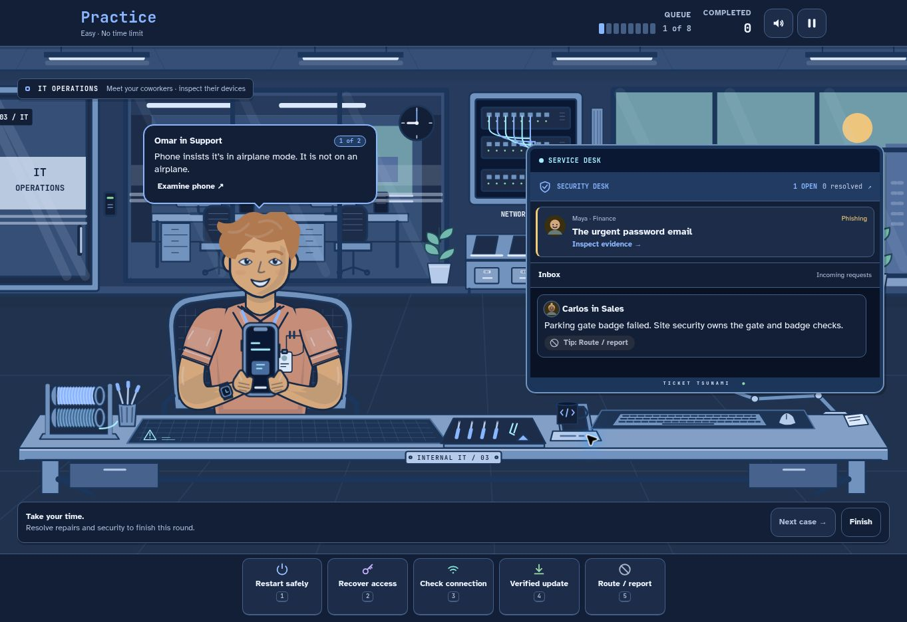
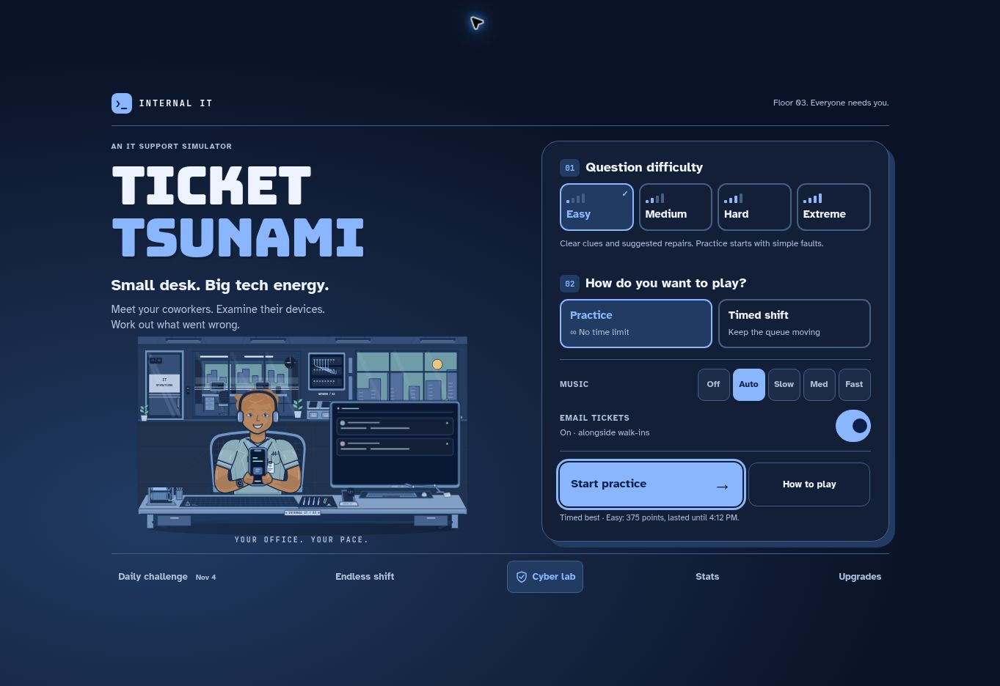
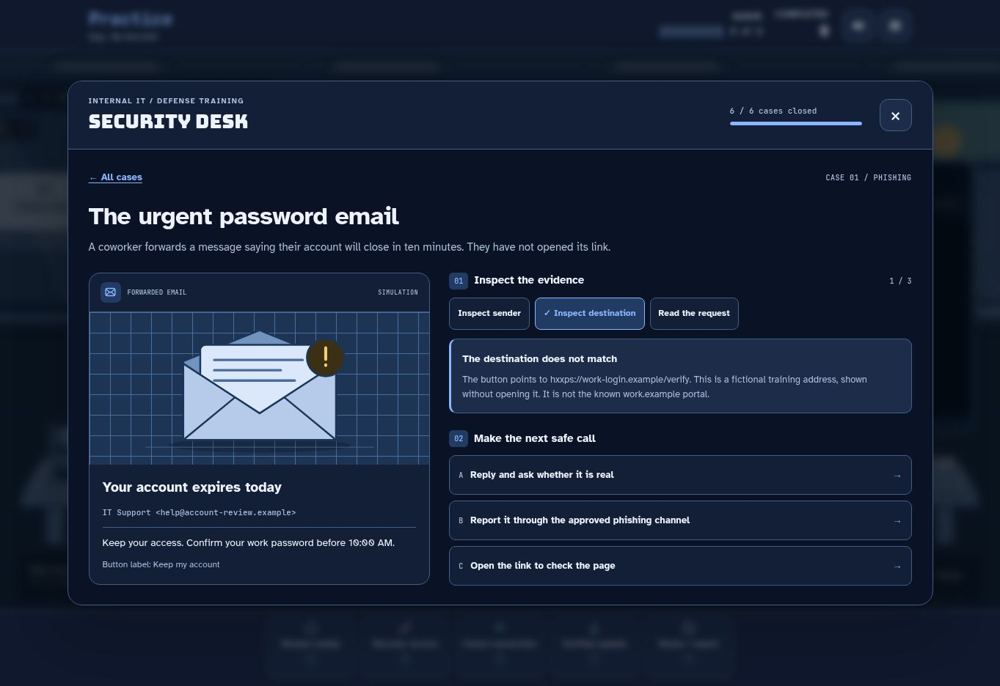
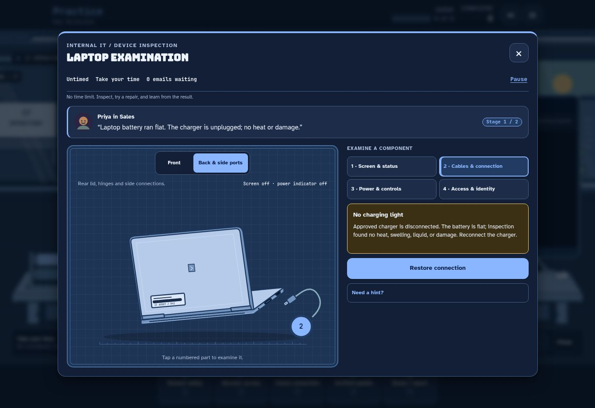

# Ticket Tsunami

A cartoon IT support simulator inside a corporate IT department. Meet coworkers, inspect the
devices they bring in, and work out the next repair from their complaint and the
physical evidence. Handle email requests on your own workstation alongside them.

### ▶ [Play it now](https://ticket-tsunami.vercel.app)

Practice at your own pace, or keep the office running through a timed shift.
No downloads, accounts, or installation.

These are real browser screenshots. The game itself uses inline SVG and CSS art;
it loads no image files.

## Choose your shift

Question difficulty, play style, music, and email tickets are all visible on the
home screen. There is no settings drawer to discover.

| Question difficulty | How diagnosis changes |
| --- | --- |
| **Easy** | Plain-language clues, a highlighted component, suggested actions. Practice starts with simple connection faults. |
| **Medium** | Find the component yourself; plain-language clues and optional hints. Practice adds more two-step cases. |
| **Hard** | No highlighted faults or workbench hints; choose from four repairs. Practice includes all six devices and three-step cases. |
| **Extreme** | Interpret technical readings and choose from five repairs, without workbench hints. The timed queue uses Hard's pace. |

- **Practice — no time limit:** no countdown, expiring tickets, score pressure,
  or automatic arrivals. Finish the current work, then choose **Next case**.
  Wrong answers explain the mismatch and let you try again. Finish whenever you
  want; practice does not change timed records, achievements, or upgrade budget.
- **Timed shift:** work from 9 AM until 5 PM, then survive overtime. Wrong repairs
  reduce patience; expiration and overflow reduce happiness. Five unhappy users
  end the shift. Faster fixes, streaks, and VIP requests pay more points.
- **Daily challenge:** a shared seeded shift with Medium diagnosis and no upgrades.
- **Endless shift:** start in overtime. There is no scheduled finish, but patience
  and happiness still run down. Use Practice if you want no time pressure.

Switch **Email tickets** off for walk-ins only. **Music** has Off, Auto, Slow,
Medium, and Fast settings; all audio is synthesized live.

## Work at the desk

1. Click a visitor to inspect their device. Read their complaint and examine the
   screen, connections, power controls, and access indicators. Front and rear
   views have numbered hotspots and equivalent labeled buttons.
2. Choose the best next action: **Restart safely**, **Recover access**,
   **Check connection**, **Verified update**, or **Route / report**. A repair may
   need two or three actions in order. Findings change after each step.
3. Read the result. A successful step explains why it worked; the next fault may
   only become visible after the first is resolved. Completion stays visible
   until you close the workbench.
4. Select email requests in the workstation inbox and use the same repair bar.
   Suspicious messages go to the reporting workflow; never follow their links.

Timed play also has returning requests, familiar office regulars, a multi-stage
projector incident, powers, upgrades, and career achievements. The queue meter
shows workload directly; there is no rising-water overlay.

**Keyboard:** 1–5 chooses a repair, ↑/↓ selects tickets, P or Esc pauses. In the
workbench, inspect a component before using a repair shortcut. Q/W/E activates
Coffee/Wiki/Auto-reply in timed play when you have a charge. The speaker button
toggles sound. **How to play** opens a guided training shift.

Works with keyboard, mouse, and touch, in light and dark mode. Motion respects
the system's reduced-motion preference.

The scenarios teach the best next action for stated evidence, not a universal
fix for every similar symptom. See the [case accuracy audit](docs/case-audit.md).

## Cyber lab

Open **Cyber lab** from Home or Pause for six untimed investigations: phishing,
MFA fatigue, unknown USB devices, ransomware containment, accidental sharing,
and verified security updates. Inspect evidence before choosing a response.
Each choice explains its consequence; unsafe choices allow another attempt.
Completed cases and safe first decisions are saved in this browser.

The lab is separate from shift scoring and never resumes a paused shift. All
messages, links and devices are fictional, inert training material.
See [training sources and verification](docs/security-training.md).

Device inspections now show distinct physical fronts and backs. The laptop has
a rear lid, hinges and side ports; unpowered hardware has no lit screen or
active power indicator. Reconnecting power updates the carried device too.

## Running locally

Plain HTML/CSS/JavaScript ES modules. No build step or dependencies:

    python3 -m http.server 8000

Open http://localhost:8000. Run the tests with:

    node --test

CI runs the same tests on every push. The timed engine is pure and seeded; the
untimed practice controller is separate. The original engine file is unchanged.

## Project layout

| Path | Purpose |
| --- | --- |
| index.html | Home, office, HUD, workbench, and overlays |
| src/engine.js | Existing pure timed-game engine |
| src/practice.js | Untimed sessions with manual case progression |
| src/main.js | Rendering, input, animation, and session integration |
| src/tickets.js | Authored complaints, existing fix IDs, and repair sequences |
| src/inspection.js | Read-only component findings for every repair stage |
| src/security.js | Six defensive investigations and browser-local progress model |
| src/security-ui.js | Cyber lab dialog, evidence, feedback, and keyboard focus |
| src/challenges.js | Diagnosis levels, evidence presentation, and saved-level migration |
| src/icons.js | Original inline SVG corporate office, coworkers, devices, and workbench art |
| src/styles.css | Layout, themes, and animation |
| src/sound.js | Synthesized audio |
| test/ | Engine, inspection, challenge, and practice tests |

See [design notes](docs/hands-on-design.md), [verification](docs/visual-verification.md),
and [ROADMAP.md](ROADMAP.md).

## License

[MIT](LICENSE)
